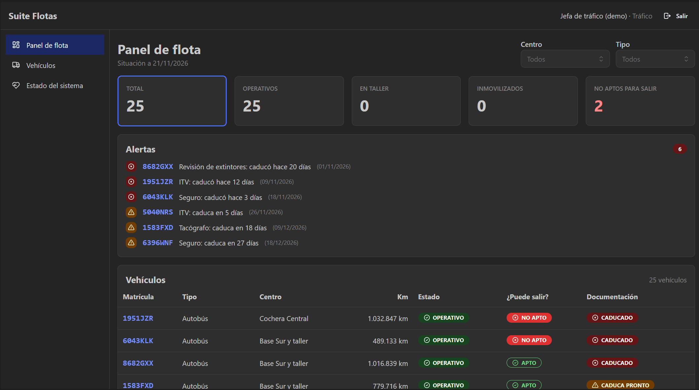
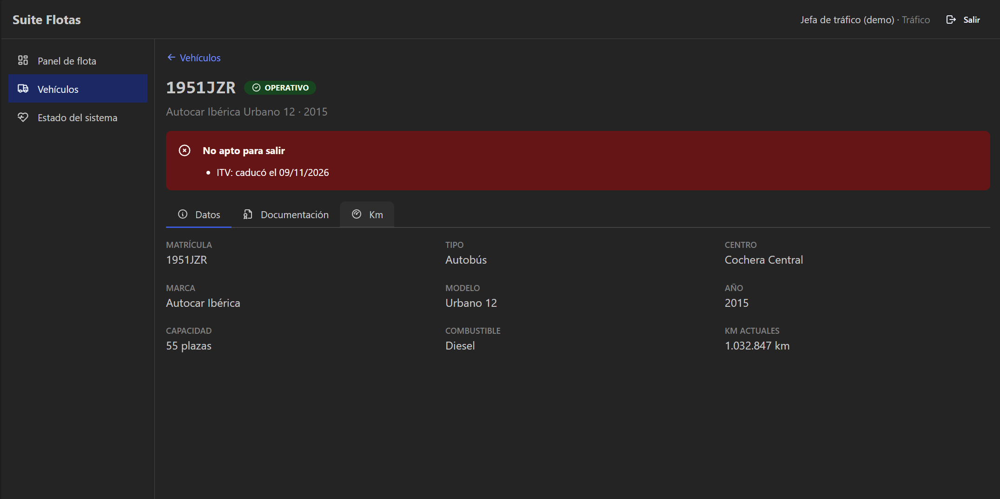
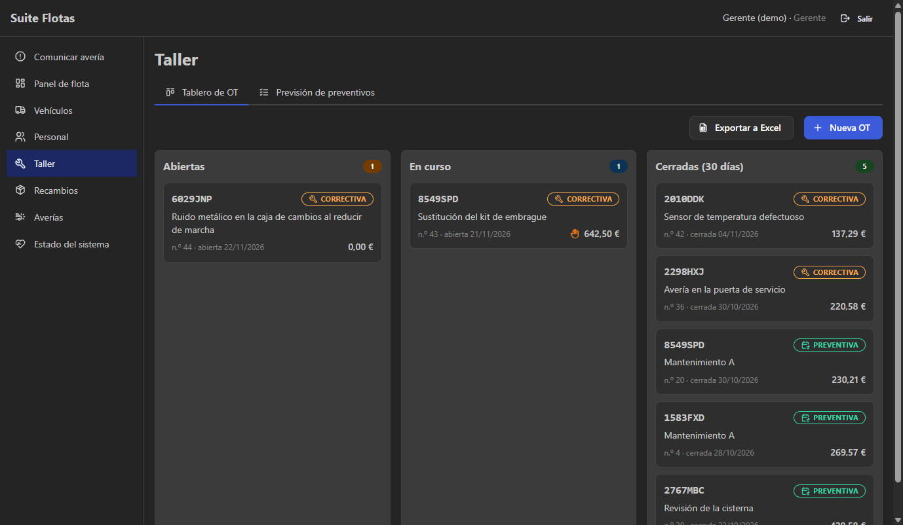
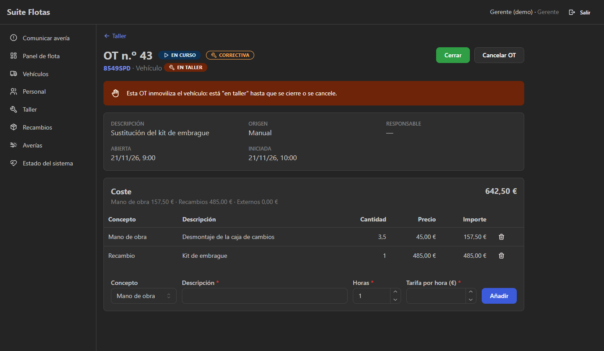
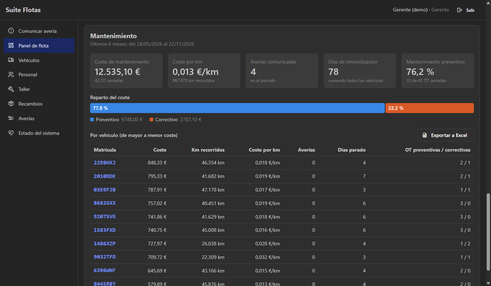
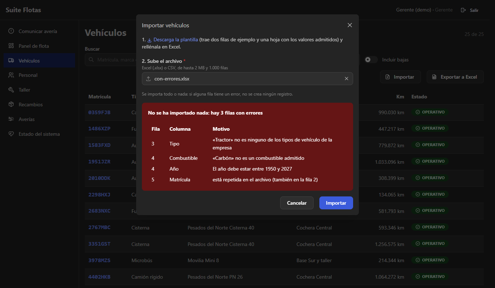

# Suite Flotas

[](https://github.com/PabloRDAI/suite-flotas/actions/workflows/ci.yml)

Suite de gestión para operadores de transporte (viajeros y mercancías) con flotas pequeñas
(5-150 vehículos): **flota, personal y mantenimiento (GMAO básico)**.

> Proyecto personal. **Solo datos ficticios.**

## Qué resuelve

- Ver en una pantalla el estado de toda la flota (operativo, en taller, inmovilizado, de baja).
- Controlar el personal y los vencimientos de su documentación (permisos, CAP, tarjeta de tacógrafo…).
- Gestionar el mantenimiento: preventivos por km o por tiempo, averías y órdenes de trabajo con coste.

La especificación completa está en [`docs/especificacion.md`](docs/especificacion.md).

## Capturas

Datos de la empresa de demostración (todo ficticio).

**Panel de flota:** contadores por estado, alertas de documentación y quién puede salir hoy.



**Ficha de vehículo:** con la ITV caducada, el vehículo no es apto para salir aunque esté operativo.



**Taller:** tablero de órdenes de trabajo por estado, con su coste.



**Orden de trabajo:** líneas de mano de obra, recambios (del catálogo, con su precio por defecto) y
trabajos externos. Mientras está abierta y el vehículo está inmovilizado, el vehículo figura "en taller".



**Indicadores de mantenimiento (últimos 6 meses):** coste por vehículo y por km, averías, días de
inmovilización y reparto entre preventivo y correctivo. Cada tabla se puede exportar a Excel.



**Importar desde Excel:** todo o nada; si alguna fila tiene errores, se listan con su motivo y no se crea ningún registro.



## Stack

| Parte | Tecnología |
|---|---|
| Backend | Python · FastAPI · SQLAlchemy · Alembic · pytest |
| Frontend | React · TypeScript · Vite |
| Base de datos | PostgreSQL (en Docker) |
| CI | GitHub Actions |

## Estructura

```
suite-flotas/
├── backend/            API REST y motor de reglas (FastAPI)
├── frontend/           Aplicación web (React + TypeScript)
├── docs/               Especificación, decisiones (ADR) y capturas
├── .github/workflows/  Integración continua (GitHub Actions)
├── docker-compose.yml  PostgreSQL para desarrollo
├── docker-compose.demo.yml  Demo completa (BD + aplicación) con un solo comando
├── Dockerfile          Imagen de la aplicación: API + web compilada
├── docker/             Script de arranque del contenedor
├── .env.example        Variables de entorno de ejemplo
└── LICENSE             Licencia MIT
```

## Probar la demo (un solo comando)

Solo hace falta [Docker Desktop](https://www.docker.com/products/docker-desktop/):

```bash
git clone https://github.com/PabloRDAI/suite-flotas.git
cd suite-flotas
docker compose -f docker-compose.demo.yml up -d --build
```

La primera vez tarda unos minutos (compila la web e instala las dependencias). Después, abre
**http://localhost:8080** y entra con `admin@demo.example.com` / `demostracion` (también `trafico@`,
`taller@` y `conductor@demo.example.com`, con la misma contraseña: cada rol ve la aplicación a su manera).

Al arrancar se crean la base de datos y la empresa de demostración (todo ficticio). Para pararla:
`docker compose -f docker-compose.demo.yml down` (con `-v` se borran también sus datos).

## Puesta en marcha (desarrollo)

Requisitos: [Git](https://git-scm.com/), [Docker Desktop](https://www.docker.com/products/docker-desktop/),
Python 3.12+ y Node.js 20+.

```bash
# 1. Variables de entorno
cp .env.example .env

# 2. Base de datos
docker compose up -d
docker compose ps        # el servicio "db" debe aparecer como "healthy"
```

Después, en dos terminales:

1. **API:** sigue [`backend/README.md`](backend/README.md) → http://127.0.0.1:8000/salud
2. **Web:** sigue [`frontend/README.md`](frontend/README.md) → http://localhost:5173

Para tener datos con los que probar, crea la empresa de demostración (todo ficticio):

```bash
cd backend
python -m app.scripts.demo     # usuarios admin|trafico|taller|conductor@demo.example.com, contraseña "demostracion"
```

## Integración continua

En cada `push` a `main`, GitHub Actions ([`ci.yml`](.github/workflows/ci.yml)) ejecuta los tests del
backend contra un PostgreSQL temporal, el linter y la compilación del frontend, y construye la imagen
Docker y arranca la demo completa para comprobar que la web, la API y el login responden.

## Plan de entrega

| Fase | Contenido | Estado |
|---|---|---|
| F0 Andamiaje | Repositorio, Docker con PostgreSQL, FastAPI, React e integración continua | ✅ Hecha |
| F1 Flota | Multiempresa, roles, vehículos, km, vencimientos, panel de flota | ✅ Hecha |
| F2 Personal | Personas, vencimientos personales, asignaciones | ✅ Hecha |
| F3 GMAO | Planes preventivos, averías, órdenes de trabajo, costes e indicadores | ✅ Hecha |
| F4 Pulido | Importar/exportar Excel, catálogo de recambios, despliegue de la demo | ⏳ Falta el despliegue |

## Licencia

[MIT](LICENSE)
