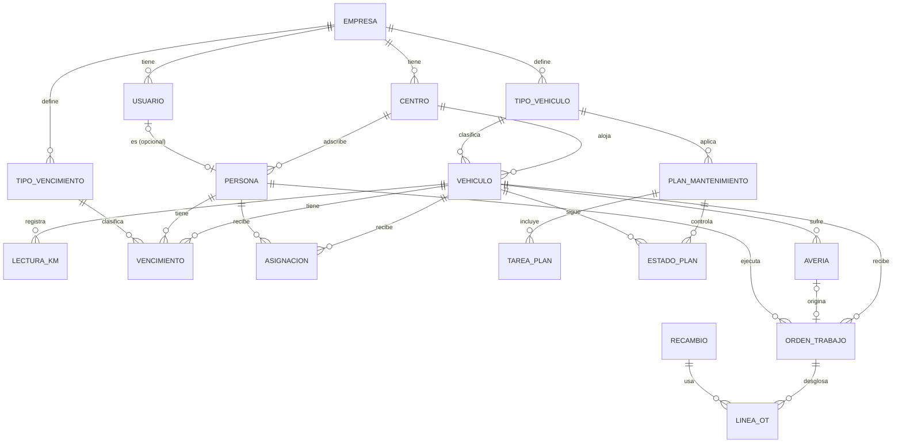

# Especificación: Suite de gestión para operadores de transporte

**Flota, personal y mantenimiento**

MVP genérico, válido para viajeros y mercancías. Solo datos ficticios. Diseño propio, sin
manuales ni capturas de software de terceros.

---

## 1. Contexto y problema

Una pyme de transporte con una flota pequeña (5-150 vehículos) controla en Excel, en papel o
de memoria qué vehículos están operativos, quién los conduce, qué documentación caduca y qué
mantenimiento toca. Consecuencias típicas: un vehículo sale con la revisión pasada, una avería
se repara tarde porque nadie la registró, y no se sabe cuánto cuesta mantener cada vehículo.

## 2. Objetivos y no-objetivos

### Objetivos del MVP

1. Ver en una pantalla el estado de toda la flota (operativo, en taller, inmovilizado, de baja).
2. Tener el personal asociado y sus vencimientos de documentación bajo control.
3. Gestionar el mantenimiento (GMAO básico): preventivo por km o por tiempo, averías y órdenes
   de trabajo con coste.

### No-objetivos (por ahora)

- Jornadas, partes de trabajo y Reglamento 561/2006 (pasan a v0.2).
- Cuadrantes, pre-nómina, licitaciones y optimización.
- Almacén completo de recambios con compras y proveedores (solo registro de recambios usados).
- Telemática, GPS o lectura automática de km y de tacógrafo.
- App móvil nativa (la web debe verse bien en el móvil, y con eso basta).

## 3. Usuarios y casos de uso

| Rol | Qué hace en el MVP |
|---|---|
| Administrador (gerente) | Da de alta la empresa, los centros, los usuarios y los catálogos. Consulta costes. |
| Jefe de tráfico | Consulta el estado de la flota, asigna conductores a vehículos y revisa vencimientos. |
| Jefe de taller o mecánico | Gestiona averías, órdenes de trabajo y planes de mantenimiento. |
| Conductor (opcional en el MVP) | Comunica una avería desde el móvil. |

## 4. Historias de usuario

- Como **jefe de tráfico** quiero ver de un vistazo qué vehículos están disponibles hoy para
  planificar los servicios sin llamar al taller.
- Como **jefe de tráfico** quiero que me avisen 30 días antes de que caduque la ITV o un seguro,
  para no tener vehículos parados por papeles.
- Como **gerente** quiero saber qué carnés, CAP o tarjetas de tacógrafo de mi personal caducan
  pronto, para programar renovaciones.
- Como **jefe de taller** quiero que el sistema me diga qué mantenimientos preventivos tocan por
  km o por fecha, para no depender de mi memoria.
- Como **conductor** quiero comunicar una avería en menos de un minuto, para que el taller la vea
  al momento.
- Como **jefe de taller** quiero convertir una avería en una orden de trabajo y registrar horas y
  recambios, para conocer el coste real de cada vehículo.
- Como **gerente** quiero ver el coste de mantenimiento por vehículo y por km, para decidir cuándo
  renovar flota.

## 5. Requisitos funcionales

Prioridad según MoSCoW: **Must** (imprescindible), **Should** (importante), **Could** (deseable),
**Won't** (no en el MVP).

### Base común (GEN)

| ID | Requisito | Prioridad | Criterio de aceptación |
|---|---|---|---|
| GEN-01 | Multiempresa: todos los datos van ligados a una empresa | Must | Un usuario de la empresa A nunca ve datos de la empresa B (test automático de API). |
| GEN-02 | Usuarios con login y roles (admin, tráfico, taller, conductor) | Must | Cada endpoint comprueba el rol; un conductor recibe 403 al intentar borrar un vehículo. |
| GEN-03 | Centros o bases (cocheras, talleres) | Must | Se puede crear un centro y asignarle vehículos y personas. |
| GEN-04 | Empresa de demostración con datos ficticios generados por script | Must | Un comando crea 1 empresa, 2 centros, 25 vehículos, 30 personas y 6 meses de historial de mantenimiento. |
| GEN-05 | Importación desde Excel o CSV de vehículos y personas | Should | Al subir la plantilla de ejemplo se crean los registros; las filas con errores se listan con su motivo sin importar nada a medias. |
| GEN-06 | Exportación a Excel de los listados | Should | Cada listado tiene un botón que descarga un .xlsx con los filtros aplicados. |
| GEN-07 | Registro de cambios (quién y cuándo) | Could | Cada vehículo, persona y orden de trabajo muestra su historial de cambios. |

### Flota (FLO)

| ID | Requisito | Prioridad | Criterio de aceptación |
|---|---|---|---|
| FLO-01 | Ficha de vehículo: matrícula, tipo, marca, modelo, año, centro, capacidad (plazas o carga), combustible y km actuales | Must | Alta, edición y baja lógica; la matrícula es única dentro de la empresa. |
| FLO-02 | Tipos de vehículo configurables (autobús, microbús, furgoneta, camión, cisterna…) | Must | El admin crea un tipo nuevo y aparece en el formulario de alta. |
| FLO-03 | Estado del vehículo: operativo, en taller, inmovilizado o de baja | Must | Si un vehículo tiene una orden de trabajo abierta marcada como "inmoviliza", su estado pasa a "en taller" automáticamente; al cerrarla, vuelve a "operativo". |
| FLO-04 | Panel de flota con contadores por estado, filtros por centro y tipo, y alertas | Must | El panel muestra totales por estado que coinciden con el listado filtrado; carga en menos de 1 s con 150 vehículos. |
| FLO-05 | Lecturas de km con fecha | Must | No se acepta una lectura menor que la anterior; los km actuales del vehículo son los de la última lectura. |
| FLO-06 | Vencimientos de documentación del vehículo (ITV, seguro, tacógrafo, tarjeta de transporte…) con tipos configurables | Must | Un vencimiento a ≤ 30 días aparece en ámbar y uno vencido en rojo, en la ficha y en el panel. El plazo de aviso es configurable por tipo. |
| FLO-07 | "Apto para salir": un vehículo con documentación vencida se marca como no apto | Should | Con la ITV vencida, el panel lo muestra como no apto aunque su estado sea operativo. |
| FLO-08 | Adjuntar documentos (PDF o imagen) a vehículos | Could | Se sube un PDF de hasta 10 MB y se descarga igual. |

### Personal (PER)

| ID | Requisito | Prioridad | Criterio de aceptación |
|---|---|---|---|
| PER-01 | Ficha de persona: nombre, puesto (conductor, mecánico, tráfico, otro), centro, fecha de alta y estado (activo o de baja) | Must | Alta, edición y baja lógica. Sin DNI ni datos bancarios en el MVP. |
| PER-02 | Vencimientos personales con tipos configurables (permiso de conducir por clase, CAP, tarjeta de conductor, reconocimiento médico, ADR…) | Must | Mismas reglas de colores que FLO-06. |
| PER-03 | Asignación conductor-vehículo con fechas (habitual o temporal) | Must | Un vehículo tiene como máximo un conductor habitual a la vez; el historial de asignaciones se conserva. |
| PER-04 | Aviso de asignación no válida | Should | Si se asigna un conductor con el permiso o el CAP vencidos, el sistema avisa (sin bloquear). |
| PER-05 | Habilitaciones del conductor por tipo de vehículo | Could | Al asignar, solo se sugieren conductores con el permiso de la clase que pide el tipo de vehículo. |

### Mantenimiento, GMAO (MAN)

| ID | Requisito | Prioridad | Criterio de aceptación |
|---|---|---|---|
| MAN-01 | Planes de mantenimiento preventivo por tipo de vehículo, con tareas e intervalos por km, por días o por lo que llegue antes | Must | Un plan "cada 30.000 km o 12 meses" genera un aviso cuando se cumple la primera de las dos condiciones (test unitario con ambos casos). |
| MAN-02 | Previsión de preventivos: lista de lo que toca en los próximos 30 días o 2.000 km | Must | La lista se ordena por urgencia y coincide con los cálculos del motor en los tests. |
| MAN-03 | Comunicar una avería: vehículo, descripción, gravedad (leve, grave, inmoviliza) y foto opcional | Must | Una avería que "inmoviliza" cambia el estado del vehículo al instante. Formulario usable en el móvil. |
| MAN-04 | Órdenes de trabajo (OT) preventivas o correctivas, creadas desde un plan, desde una avería o a mano | Must | Al crear una OT desde una avería, la avería queda enlazada y pasa a "en reparación". |
| MAN-05 | Flujo de la OT: abierta → en curso → cerrada (o cancelada) | Must | Al cerrar se exigen los km y la fecha; si era preventiva, el plan recalcula la siguiente fecha y los siguientes km. |
| MAN-06 | Coste de la OT: horas de mano de obra × tarifa, recambios usados y trabajos externos | Must | El total de la OT es la suma de sus líneas (test unitario). |
| MAN-07 | Historial de mantenimiento por vehículo | Must | La ficha del vehículo lista todas sus OT con fecha, tipo, km y coste. |
| MAN-08 | Indicadores: coste por vehículo y por km, nº de averías, días de inmovilización y % de preventivo frente a correctivo | Should | Los valores del panel coinciden con un cálculo manual sobre los datos de demostración. |
| MAN-09 | Catálogo de recambios con referencia y precio, sin control de stock | Should | Al añadir un recambio a una OT se rellena su precio por defecto. |
| MAN-10 | Stock de recambios con mínimos | Won't (MVP) | — |

## 6. Requisitos no funcionales

- **Seguridad:** contraseñas con hash (argon2 o bcrypt), sesiones con token, HTTPS al desplegar
  y aislamiento por empresa en todas las consultas (GEN-01).
- **Privacidad (RGPD):** datos mínimos del personal; ningún dato real en desarrollo ni en la demo.
- **Rendimiento:** listados y panel por debajo de 1 s con 150 vehículos y 300 personas.
- **Usabilidad:** pantallas con pocos campos visibles, colores de alerta coherentes (verde, ámbar
  y rojo, siempre con texto o icono, no solo color) y formulario de avería pensado para el móvil.
- **Calidad:** tests del motor de reglas (vencimientos, preventivos, estados y costes) con pytest;
  integración continua en GitHub Actions.
- **Configurable, no codificado:** los plazos legales (ITV, CAP, tarjetas) no se escriben en el
  código; son tipos de vencimiento que configura la empresa.

## 7. Diseño de alto nivel

### Modelo de datos

| Entidad | Campos clave |
|---|---|
| VEHICULO | id, empresa_id, centro_id, tipo_id, matricula, marca, modelo, año, capacidad, combustible, km_actuales, estado, activo |
| PERSONA | id, empresa_id, centro_id, nombre, puesto, fecha_alta, activo, usuario_id (opcional) |
| TIPO_VENCIMIENTO | id, nombre, aplica_a (vehiculo o persona), dias_aviso |
| VENCIMIENTO | id, tipo_id, vehiculo_id o persona_id, fecha_caducidad, notas, adjunto |
| ASIGNACION | id, persona_id, vehiculo_id, desde, hasta, habitual |
| PLAN_MANTENIMIENTO | id, tipo_vehiculo_id, nombre, intervalo_km, intervalo_dias |
| ESTADO_PLAN | vehiculo_id, plan_id, ultima_fecha, ultimos_km, proxima_fecha, proximos_km |
| AVERIA | id, vehiculo_id, comunicada_por, fecha, descripcion, gravedad, estado, foto |
| ORDEN_TRABAJO | id, vehiculo_id, tipo (preventiva o correctiva), origen (plan, avería o manual), estado, inmoviliza, apertura, cierre, km, responsable_id |
| LINEA_OT | id, ot_id, concepto (mano de obra, recambio o externo), recambio_id, cantidad, precio_unitario |

### Reglas del motor (núcleo testeable, en Python puro)

1. **Estado del vehículo** = de baja si está inactivo; en taller si tiene una OT abierta con
   inmoviliza; inmovilizado si tiene una avería "inmoviliza" sin OT; si no, operativo.
2. **Semáforo de vencimientos:** rojo si fecha_caducidad < hoy; ámbar si quedan ≤ dias_aviso;
   verde en otro caso.
3. **Próximo preventivo:** proxima_fecha = ultima_fecha + intervalo_dias y proximos_km =
   ultimos_km + intervalo_km; vence cuando se alcanza la primera.
4. **Coste de una OT** = Σ (cantidad × precio_unitario) de sus líneas.

### Pantallas

1. **Panel de flota:** contadores por estado, alertas (vencimientos, preventivos y averías
   abiertas) y tabla filtrable.
2. **Ficha de vehículo:** pestañas de datos, documentación, asignaciones, mantenimiento y costes.
3. **Personal:** listado con semáforo de vencimientos y ficha con asignaciones.
4. **Taller:** tablero de OT por estado (abierta, en curso, cerrada) y previsión de preventivos.
5. **Comunicar avería:** formulario de una pantalla, pensado para el móvil.
6. **Configuración:** centros, tipos de vehículo, tipos de vencimiento, planes y usuarios.

### API (REST, FastAPI)

`/auth` · `/centros` · `/vehiculos` (+ `/{id}/km`, `/{id}/historial`) · `/personas` ·
`/vencimientos` · `/asignaciones` · `/planes` · `/preventivos/prevision` · `/averias` ·
`/ordenes-trabajo` (+ `/{id}/lineas`, `/{id}/cerrar`) · `/panel` · `/importar` · `/exportar`

### Estructura del repositorio

`backend/` (FastAPI, SQLAlchemy, Alembic, pytest) · `frontend/` (React + TypeScript con Vite) ·
`docker-compose.yml` (PostgreSQL) · `docs/` (esta especificación y capturas).

## 8. Métricas de éxito

- **Calidad:** el motor de reglas tiene ≥ 90 % de cobertura de tests y la integración continua
  está en verde.
- **Uso (si hay pilotos):** tiempo para comunicar una avería < 1 min; 0 vehículos con
  documentación vencida sin alerta; % de preventivo frente a correctivo.

## 9. Riesgos y preguntas abiertas

| Riesgo | Mitigación |
|---|---|
| Alcance demasiado grande | Entregar por capas: primero Flota, luego Personal y luego GMAO, con una demo al final de cada una. |
| Atascarse con el frontend | Usar una librería de componentes; primero listados y formularios sencillos y después lo visual. |
| Datos personales si algún día hay clientes | Datos mínimos y revisión legal antes de cualquier piloto. |

**Preguntas abiertas** (se resuelven más adelante, no bloquean):

- ¿Qué vencimientos de vehículo y de personal son imprescindibles para una pyme de viajeros y
  para una de mercancías? (Se confirmará en fuente oficial cuando toque.)
- ¿Los mecánicos son propios o el taller es externo? El MVP admite ambos casos: horas propias o
  línea de "trabajo externo".
- ¿Hace falta controlar neumáticos aparte, por posición y desgaste? Queda para después del MVP.
- ¿Qué librería de componentes usar en el frontend? Se decidirá con un ADR al empezar el frontend.

## 10. Plan de entrega

| Fase | Contenido | Demo al final |
|---|---|---|
| F0 Andamiaje | Repositorio, Docker con PostgreSQL, FastAPI, React e integración continua | "Hola mundo" conectado a la base de datos |
| F1 Flota | GEN-01 a 04 y FLO-01 a 07 | Panel de flota con la empresa de demostración |
| F2 Personal | PER-01 a 04 | Semáforo de vencimientos del personal |
| F3 GMAO | MAN-01 a 08 | Tablero de taller y costes por vehículo |
| F4 Pulido | GEN-05 y 06, MAN-09 y despliegue de la demo | Demo pública con datos ficticios |
